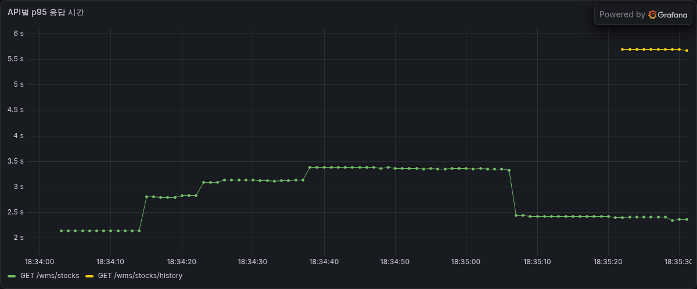
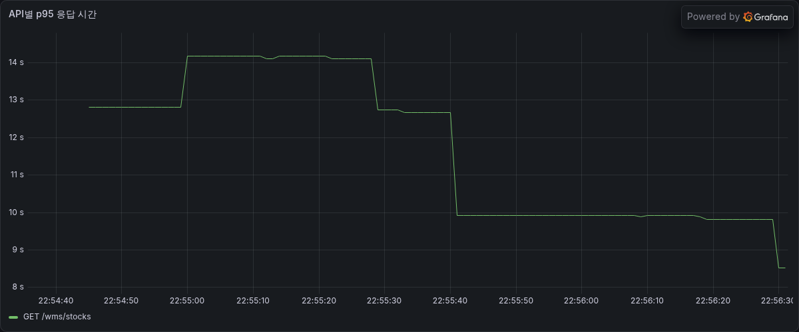
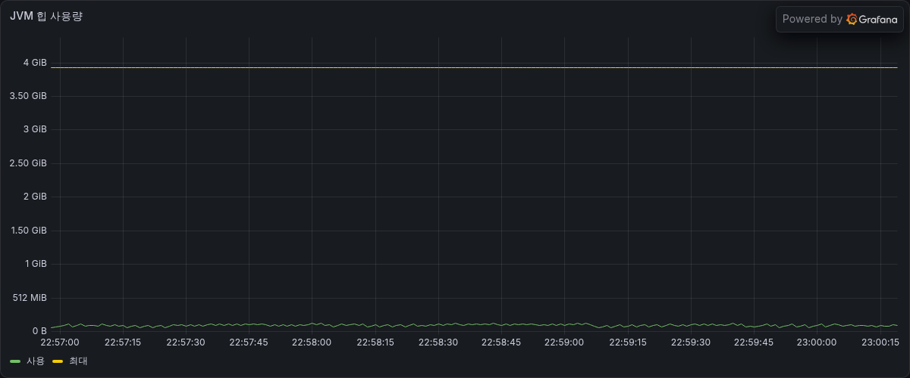
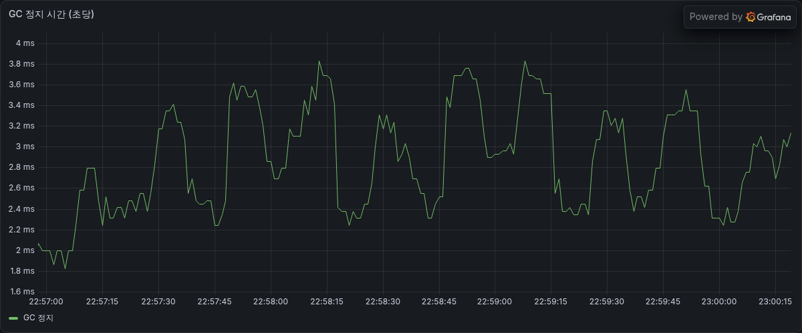

# 동시성·속도 측정 (chore/perf-scenarios)

develop 에 병합하지 않는 측정 전용 브랜치다. 측정 스크립트와 원본 결과를 보관한다.

| 항목 | 값 |
| --- | --- |
| 측정일 | 2026-10-09 |
| 측정자 | 신승민 |
| 전제 | 서버 1대 |

## 1. 환경

| 항목 | 값 |
| --- | --- |
| PC | Intel Core i5-1335U (10코어 12스레드), RAM 16GB, Windows 11 Home |
| Docker | CPU 12, 메모리 7.6GB |
| 서버 | Spring Boot 로컬 실행, HikariCP 풀 10, `AUTH_ENABLED=false`, SQL 로그 끔 |
| DB | MySQL 8.0 (docker `wms-db-1`), `wms_db` |
| 데이터 | `sample2.sql`, 회차마다 다시 적재 |
| 도구 | k6 (docker), Prometheus 1초 수집, Grafana |
| 부하 | VU 20명 동시 1회 요청 (실험 4만 150명) |
| 반복 | 예열 1~3회 제외, 본 측정 5회 |
| 속도 | 95% 응답 시간(p95)의 5회 중앙값 |

## 2. 비교한 코드

| 이름 | 내용 | 커밋 |
| --- | --- | --- |
| 옛 코드 | 보호 없음 | `v0.2-before-lock` (7766bc9) |
| 워커 4 | develop 코드, 적재 스레드풀 워커 4. 서비스 코드는 옛 코드와 같음 | `v0.2-measure-1009` (30913ed) |
| 대기열 | develop 코드, 적재 스레드풀 워커 1, 대기 100 | `v0.2-measure-1009` (30913ed) |
| 자바 잠금 | 할당·출고확정 메서드 `synchronized` | 0b7959e |
| 비관적 잠금 | 할당 시 출고 문서 행 `PESSIMISTIC_WRITE` | 80c76a6 |
| 입고 조건부 UPDATE | 검수 상세 상태를 `WHERE status='INSPECTED'` 로 변경 | 7b04a27 |
| 출고 조건부 UPDATE | `allocated_qty = allocated_qty + ? WHERE qty - allocated_qty >= ?` | dd09e53 |

| 참고 | 내용 |
| --- | --- |
| 대기열 적용 범위 | 적재에만 있음. 할당 실험에서는 대기열 서버 = 보호 없음 서버 |
| 옛 코드 구조 | 적재·할당 모두 "조회 → 자바에서 확인·계산 → 행 전체 저장" |

## 3. 결과

### 실험 1. 같은 검수 상세를 20명이 동시에 적재

| 정답 | 성공 1, 재고 1행 80개 |
| --- | --- |

| 코드 | 응답 (5회 동일) | DB | p95 |
| --- | --- | --- | --- |
| 옛 코드 | 성공 10, 409 10 | 10행 800개 | 245ms |
| 워커 4 | 성공 4, 409 16 | 4행 320개 | 169ms |
| 대기열 | 성공 1, 409 19 | 1행 80개 | 244ms |
| 입고 조건부 UPDATE | 성공 1, 409 19 | 1행 80개 | 93ms |

| 분석 | 내용 |
| --- | --- |
| 옛 코드 중복 수 | 5회 모두 정확히 10건. HikariCP 풀 크기(10)와 같음 |
| 워커 4 중복 수 | 워커 수(4)와 같음 |
| 속도 | 조건부 UPDATE 가 대기열보다 2.6배 빠름 |

### 실험 2. 두 출고 문서가 같은 재고(가용 50)를 동시에 할당

| 조건 | 문서 14 (재고 12에서 50 + 재고 3에서 10), 문서 990 (재고 12에서 50), 각 10명 |
| --- | --- |
| 정답 | 한 문서만 할당 |

| 코드 | 문서 14 (5회 합계) | 문서 990 (5회 합계) | 초과 약속 | p95 |
| --- | --- | --- | --- | --- |
| 보호 없음 | 성공 5, 409 18, 500 27 | 성공 3, 409 16, 500 31 | 5회 중 3회 | 151ms |
| 자바 잠금 | 성공 0, 409 50 | 성공 5, 409 45 | 0 | 421ms |
| 비관적 잠금 | 성공 5, 409 45 | 성공 5, 409 40, 500 5 | 5회 중 5회 | 257ms |
| 출고 조건부 UPDATE | 성공 0, 409 50 | 성공 5, 409 45 | 0 | 116ms |

| 분석 | 내용 |
| --- | --- |
| 초과 약속이 안 보임 | 보호 없음에서 초과 약속이 난 회차도 재고 12의 선점은 50. 두 요청이 각각 0 + 50 을 저장함. 피킹 상세 합계로만 확인됨 |
| 500 비율 | 보호 없음 58% |
| 비관적 잠금 실패 원인 | 문서 행을 잠금. 문서 14와 990은 다른 행이라 서로 막지 못함 |
| 속도 | 조건부 UPDATE 가 자바 잠금보다 3.6배 빠름 |

### 실험 3. 같은 재고(수량 50)에 적재 +80 과 할당 +50 이 동시에

| 조건 | 적재 10명, 할당 10명 |
| --- | --- |
| 정답 | 수량 130, 선점 50, 피킹 2행 55개 |

| 코드 | 적재 (5회 합계) | 할당 (5회 합계) | DB (5회 동일) | p95 |
| --- | --- | --- | --- | --- |
| 옛 코드 | 성공 26, 409 24 | 성공 10, 409 20, 500 20 | 수량 130, 선점 0, 피킹 4행 110 | 215ms |
| 워커 4 | 성공 20, 409 30 | 성공 10, 409 2, 500 38 | 옛 코드와 같음 | 216ms |
| 대기열 | 성공 5, 409 45 | 성공 5, 500 45 | 수량 50, 선점 50 | 212ms |
| 입고 조건부 UPDATE | 성공 5, 409 45 | 성공 10, 500 40 | 수량 130, 선점 50, 피킹 4행 110 | 159ms |
| 출고 조건부 UPDATE | 성공 28, 409 22 | 성공 20, 409 30 | 수량 130, 선점 50 또는 0, 피킹 8행 220 | 398ms |

| 분석 | 내용 |
| --- | --- |
| 덮어쓰기 원인 | 적재는 `qty`, 할당은 `allocated_qty` 를 바꾸지만 둘 다 읽어 둔 값으로 행 전체를 저장. 나중에 저장한 쪽이 다른 쪽 변경을 지움 |
| 대기열 | 적재끼리만 순서를 정함. 할당과의 충돌은 못 막아 5회 모두 적재 +80 사라짐 |
| 입고 조건부 UPDATE | 수량·선점은 이번 5회에서 맞았으나 재고는 여전히 행 전체 저장. 할당은 매회 2건 성공 |
| 출고 조건부 UPDATE | 할당은 DB 에서 올렸지만 먼저 재고를 읽은 적재가 선점을 0으로 되돌림. 매회 할당 4건, 재고 130 에 200개 약속 |
| 결론 | 같은 재고 행을 쓰는 적재·할당·출고·취소를 모두 바꿔야 함. 모두 바꾼 서버는 미측정 |

덮어쓰기 순서 (옛 코드)

| 단계 | 적재 | 할당 | 재고 (수량, 선점) |
| --- | --- | --- | --- |
| 1 | 읽음 (50, 0) | 읽음 (50, 0) | 50, 0 |
| 2 | 계산: 수량 130 | 계산: 선점 50 | 50, 0 |
| 3 | | 저장 `qty=50, allocated_qty=50` | 50, 50 |
| 4 | 저장 `qty=130, allocated_qty=0` | | 130, 0 (할당 +50 사라짐) |

### 실험 4. 같은 검수 상세를 150명이 동시에 적재

| 코드 | 응답 (5회) | DB | p95 / 최대 |
| --- | --- | --- | --- |
| 옛 코드 | 성공 10, 409 140 | 10행 800개 | 282ms / 354ms |
| 대기열 | 성공 1, 409 100~104, 503 39~49 | 1행 80개 | 670ms / 789ms |
| 입고 조건부 UPDATE | 성공 1, 409 149, 503 0 | 1행 80개 | 175ms / 396ms |

| 분석 | 내용 |
| --- | --- |
| 옛 코드 | 150명에서도 중복 10건 (실험 1과 같음) |
| 대기열 | 100칸 초과 요청은 503, 500 없음. 조건부 UPDATE 보다 3.8배 느림 |
| 조건부 UPDATE | 대기열 없이도 500·503 없음. 요청은 DB 커넥션 풀에서 대기 |
| 기타 | 대기열 서버 1회에서 k6 연결 실패 10건, 원인 미확인 |

### 실험 5. 서로 다른 검수 상세 20개를 서로 다른 칸에 동시에 적재

| 조건 | 충돌 없음. 5회 모두 정상 처리 |
| --- | --- |

| 코드 | p95 | 옛 코드 대비 |
| --- | --- | --- |
| 옛 코드 | 130ms | 1.0 |
| 입고 조건부 UPDATE | 153ms | 1.2배 |
| 워커 4 | 247ms | 1.9배 |
| 대기열 | 819ms | 6.3배 |

| 분석 | 내용 |
| --- | --- |
| 대기열 | 겹치지 않는 20건도 하나씩 처리. 건당 약 40ms |
| 조건부 UPDATE | 서로 다른 행은 대기 없음 (잠금 대기 0) |

### 서버 오류 (500) 원인

| 조건 | 보호 없음 서버, 실험 2 1회, `LOGGING_LEVEL_ORG_SPRINGFRAMEWORK_WEB=DEBUG` |
| --- | --- |

| 응답 | 건수 | 내용 |
| --- | --- | --- |
| 500 | 9 | 모두 `CannotAcquireLockException` (MySQL deadlock). 8건 `update document ...`, 1건 `update stock ...` |
| 409 | 10 | "이미 할당된 품목입니다" 6, "가용 수량을 넘습니다" 4 |

| 분석 | 내용 |
| --- | --- |
| 조건부 UPDATE 서버 | 500 없음 |
| 현재 500 핸들러 | 예외를 로그로 남기지 않음 |

## 4. 정리

| 대상 | 결정 | 근거 |
| --- | --- | --- |
| 중복 처리 (적재·할당·출고확정 상태) | 상태 조건부 UPDATE | 실험 1, 4 |
| 재고 수량 (적재·할당·출고·취소) | `qty = qty + ?` 형태의 UPDATE | 실험 2 |
| 적용 범위 | 같은 재고 행을 쓰는 모든 코드 | 실험 3 |
| 칸 용량 등 여러 행 합계 검사 | 대기열 또는 칸 행 잠금 (미측정) | 한 줄 UPDATE 로 불가 |

| 사용하지 않는 방식 | 이유 |
| --- | --- |
| 자바 잠금 | 조건부 UPDATE 보다 3.6배 느림. 관계없는 요청도 대기 |
| 비관적 잠금 (문서 행) | 5회 모두 초과 약속 |
| 대기열 단독 | 충돌 없는 경우 6.3배 느림. 적재·할당 충돌을 못 막음 |

| 조건부 UPDATE 규칙 | 내용 |
| --- | --- |
| 1 | 반환값 0 이면 409 |
| 2 | 같은 행을 쓰는 곳에서 엔티티 setter + save 제거 |
| 3 | WHERE 에 PK 포함 |
| 4 | 트랜잭션 앞쪽에서 실행, deadlock 은 409 로 변환 |

## 5. 한계

| 항목 | 내용 |
| --- | --- |
| 미측정 | 모든 쓰기를 조건부 UPDATE 로 바꾼 서버, 대기열 + 조건부 UPDATE 조합, 칸 용량 검사 |
| 횟수 | 조합마다 5회. 다음 측정은 10회 |
| 예열 | 실험 1·2 는 1회, 3~5 는 3회. 1회차가 가장 느린 경향이 있어 중앙값으로 비교. 평균·중앙값·앞 2회 제외 어느 기준이든 순위 같음 |
| 그래프 | Grafana PNG 파일 이름이 한 칸씩 밀림, 15초 간격. 판정은 JSON 과 DB 스냅샷으로 함 |

## 6. 회차별 p95 (ms)

| 실험 | 코드 | 1 | 2 | 3 | 4 | 5 | 중앙값 |
| --- | --- | --- | --- | --- | --- | --- | --- |
| 1 | 옛 코드 | 245 | 292 | 234 | 253 | 212 | 245 |
| 1 | 워커 4 | 229 | 163 | 222 | 169 | 149 | 169 |
| 1 | 대기열 | 449 | 246 | 210 | 244 | 171 | 244 |
| 1 | 입고 조건부 UPDATE | 99 | 148 | 93 | 81 | 78 | 93 |
| 2 | 보호 없음 | 247 | 183 | 131 | 132 | 151 | 151 |
| 2 | 자바 잠금 | 499 | 458 | 356 | 360 | 421 | 421 |
| 2 | 비관적 잠금 | 257 | 227 | 338 | 283 | 213 | 257 |
| 2 | 출고 조건부 UPDATE | 147 | 134 | 111 | 116 | 108 | 116 |
| 3 | 옛 코드 | 239 | 180 | 201 | 226 | 215 | 215 |
| 3 | 워커 4 | 284 | 213 | 195 | 253 | 216 | 216 |
| 3 | 대기열 | 211 | 242 | 224 | 196 | 212 | 212 |
| 3 | 입고 조건부 UPDATE | 136 | 170 | 159 | 134 | 162 | 159 |
| 3 | 출고 조건부 UPDATE | 398 | 341 | 444 | 482 | 315 | 398 |
| 4 | 옛 코드 | 282 | 302 | 267 | 300 | 258 | 282 |
| 4 | 대기열 | 670 | 736 | 634 | 655 | 683 | 670 |
| 4 | 입고 조건부 UPDATE | 175 | 171 | 166 | 363 | 196 | 175 |
| 5 | 옛 코드 | 130 | 133 | 130 | 123 | 122 | 130 |
| 5 | 워커 4 | 247 | 239 | 249 | 247 | 241 | 247 |
| 5 | 대기열 | 721 | 819 | 888 | 740 | 824 | 819 |
| 5 | 입고 조건부 UPDATE | 153 | 284 | 151 | 161 | 141 | 153 |

## 7. 파일

| 경로 | 내용 |
| --- | --- |
| `scripts/perf/consistency.js` | k6 동시 요청 (carry, oversell, cross, spread …) |
| `scripts/perf/run.ps1` | 1회 측정: 데이터 초기화 → 준비 → 전 스냅샷 → k6 → 후 스냅샷 |
| `scripts/perf/check_*.sql` | 시나리오별 DB 확인 쿼리 |
| `scripts/perf/grafana-png.ps1` | 측정 구간 Grafana 패널 PNG 저장 |
| `scripts/perf/speed/` | 속도 측정 (대량 데이터 생성, k6, 실행 스크립트) |
| `scripts/perf/result-<실험>-<코드>/` | 원본 결과 (회차별 JSON, 전후 DB 스냅샷, png) |
| `monitoring/` | Prometheus, Grafana, 대시보드 |

| 실험 | 옛 코드 | 워커 4 | 대기열 | 자바 잠금 | 비관적 잠금 | 조건부 UPDATE |
| --- | --- | --- | --- | --- | --- | --- |
| 1 | result-S1-I-B0 | result-S1-I-W4 | result-S1-I-W1 | | | result-S1-I-CU |
| 2 | | result-S7-O-base | | result-S7-O-SYNC | result-S7-O-PL | result-S7-O-CU |
| 3 | result-S2-I-B0 | result-S2-I-W4 | result-S2-I-W1 | | | result-S2-I-CU, result-S2-O-CU |
| 4 | result-S6-I-B0 | | result-S6-I-W1 | | | result-S6-I-CU |
| 5 | result-S5-I-B0 | result-S5-I-W4 | result-S5-I-W1 | | | result-S5-I-CU |

| 실행 (WMS 폴더) | 명령 |
| --- | --- |
| 서버 (측정할 커밋의 worktree) | `$env:AUTH_ENABLED="false"; $env:LOGGING_LEVEL_ORG_HIBERNATE_SQL="warn"; .\gradlew :wms-core:bootRun` |
| 측정 1회 | `powershell -ExecutionPolicy Bypass -File scripts/perf/run.ps1 -S carry -Run 1 -Database wms_db -Sample <sample2.sql 경로>` |

## 8. 속도 측정 (Before)

동시성과 별개로, 데이터가 늘면 API 가 얼마나 느려지는지 쟀다. 기준 코드는 develop (`v0.2-measure-1009`, 30913ed). 고치기 전 상태다.

| 항목 | 1천 규모 | 1만 규모 |
| --- | --- | --- |
| 측정일 | 2026-10-09 | 2026-10-09 |
| 재고 행 | 1,099 | 10,055 (9.1배) |
| 처리 상세 행 | 1,107 | 10,063 |
| 문서 / 칸 / LOT | 345 / 342 / 556 | 2,079 / 2,076 / 5,034 |
| 동시 사용자 (VU) | 1 | 1 |
| 예열 (버림) | 1회 × 3요청 | 1회 × 2요청 |
| 본 측정 | 3회 × 10요청 | 3회 × 3요청 |
| 대표값 | 회차별 p95 의 중앙값 | 같음 |
| 실패 | 0 | 0 |
| 걸린 시간 | 약 15분 | 약 22분 |

처음에는 VU 5, 50요청으로 계획했지만 1천 규모에서도 요청 하나가 2~5초라 한 API 에 10분이 넘게 걸려 줄였다. 동시 접속이 아니라 요청 1건의 처리 시간을 보는 측정이다.

### 결과 (p95, ms)

| API | 설명 | 1천 | 1만 | 배율 | 응답 크기 (1만) |
| --- | --- | --- | --- | --- | --- |
| recommend | 적치 추천 | 1,731 | 19,367 | 11.2 | 1KB |
| history | 재고 이력 | 4,870 | 19,592 | 4.0 | 5.4MB |
| carry | 적재 | 2,709 | 10,932 | 4.0 | - |
| picking | 피킹 리스트 | 2,242 | 10,447 | 4.7 | 1KB |
| inspections | 검수 결과 목록 | 2,050 | 10,165 | 5.0 | 1KB |
| alloc | 할당 | 2,307 | 9,999 | 4.3 | - |
| ship | 출고확정 | 2,187 | 9,971 | 4.6 | - |
| stocks | 재고 목록 | 2,907 | 9,367 | 3.2 | 2.6MB |
| outbound_detail | 출고 상세 | 1,930 | 6,821 | 3.5 | 1KB |
| preview | 할당 미리보기 | 1,498 | 5,555 | 3.7 | - |
| inbounds | 입고 목록 | 192 | 619 | 3.2 | 284KB |
| inbound_detail | 입고 상세 | 142 | 295 | 2.1 | 1KB |
| outbounds | 출고 목록 | 105 | 116 | 1.1 | 293KB |
| locations | 적재 칸 목록 | 59 | 50 | 0.9 | 98KB |

1만 규모에서 14개 중 10개가 5초를 넘었다. 요구사항 NFR-05 (목록 조회 1초 이내) 를 재고 목록·이력 모두 못 지킨다.

### 원인

| 관찰 | 해석 |
| --- | --- |
| 응답이 1KB 인 API (검수 결과, 피킹 리스트, 출고 상세) 도 6~10초 | 응답 크기 문제가 아니다. 결과 몇 줄을 만들려고 표 전체를 읽는다 |
| develop 서비스 코드에 `findAll()` 30곳 이상 | 문서 하나를 볼 때도 `documentItemRepository.findAll()` 로 전체를 가져와 자바에서 `documentId` 로 거른다. 연관 엔티티를 꺼낼 때마다 쿼리가 또 나간다 (N+1) |
| 적치 추천만 11.2배 | `recommend` 가 칸 2,076개마다 재고 10,055행 전체를 돈다 (칸 × 재고). 데이터가 늘면 곱으로 느려진다 |
| JVM 힙 100MB 안팎 (최대 4GB), GC 4ms 이하 | 메모리·GC 는 병목이 아니다 |
| DB 연결 사용 1~2개 | 연결 풀도 병목이 아니다. 요청 하나가 쿼리를 아주 많이 보낸다 |
| 재고 목록 2.6MB, 이력 5.4MB | 페이징 없이 전체를 내려준다. 화면도 이걸 다 그린다 |
| 출고 목록·칸 목록은 그대로 | 이미 필요한 것만 조회하는 코드라 데이터가 늘어도 거의 같다 |

### 고칠 내용

| 대상 | 고칠 내용 | Jira |
| --- | --- | --- |
| 입고 (상세, 검수 결과, 적재, 추천) | `findAll()` 을 `findByDocumentId` 같은 조건 조회로. 추천은 칸별 재고를 한 번에 묶어 계산 | ED-71 |
| 출고 (상세, 미리보기, 할당, 피킹, 출고확정) | 같은 방식 | ED-73 |
| 재고 목록 | 공통 페이징 (`Pageable` + `PageResponse`) | ED-74 |
| 재고 이력 | 이번 범위에서 제외 | - |

After 측정은 같은 스크립트·같은 데이터로 다시 잰다 (10/13~14).

### 그래프

| 그림 | 파일 |
| --- | --- |
| 재고 목록 API p95 (1천) |  |
| 재고 목록 API p95 (1만) |  |
| 재고 이력 JVM 힙 (1만) |  |
| 재고 이력 GC 멈춤 (1만) |  |

나머지 PNG 는 `result-speed-<규모>/png/` 에 있다. 1천은 14개 API × 11개 패널, 1만은 5개 API (stocks, history, outbound_detail, carry, alloc) × 5개 패널 (처리량, p95, API별 p95, JVM 힙, GC).

### 실행

| 순서 | 명령 (WMS 폴더, PowerShell) |
| --- | --- |
| 1 | 서버: `$env:AUTH_ENABLED="false"; $env:LOGGING_LEVEL_ORG_HIBERNATE_SQL="warn"; .\gradlew :wms-core:bootRun` |
| 2 | `$env:WMS_DB_PWD = "<DB 비밀번호>"` |
| 3 | 1천: `powershell -ExecutionPolicy Bypass -File scripts/perf/speed/speed.ps1 -Scale 1000 -Vus 1 -Warmup 1 -WarmIter 3 -Runs 3 -Iter 10` |
| 4 | 1만: `... -Scale 10000 -Vus 1 -Warmup 1 -WarmIter 2 -Runs 3 -Iter 3` |
| 5 | PNG 만 다시: `powershell -ExecutionPolicy Bypass -File scripts/perf/grafana-png.ps1 -ResultDir scripts/perf/result-speed-10000 -S stocks -PanelIds "2,3,9,10,11"` |

결과는 `scripts/perf/result-speed-<규모>/` 에 회차별 JSON (`<API>-<회차>.json`), `data.txt` (만든 행 수), `png/` 로 남는다.
